<h1 align="center">Bende Var</h1>

<p align="center">
  <b>What you need is already in your community.</b><br>
  A mobile app where people who share the same place : a school, a dorm or a company , meet each other's needs.
</p>

<p align="center">
  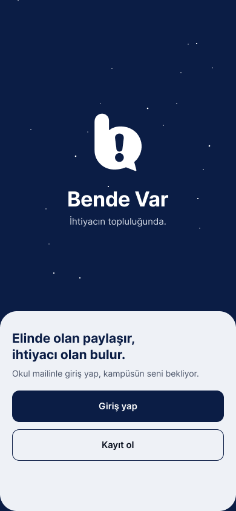
  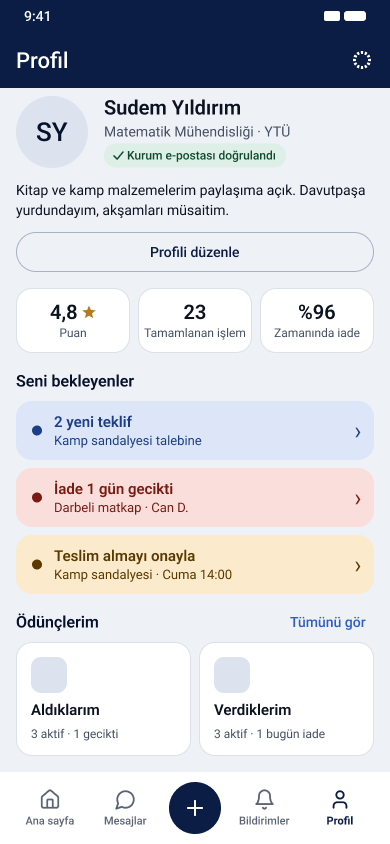
  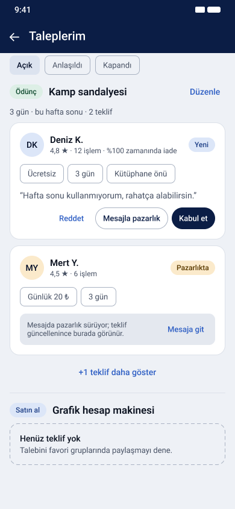
  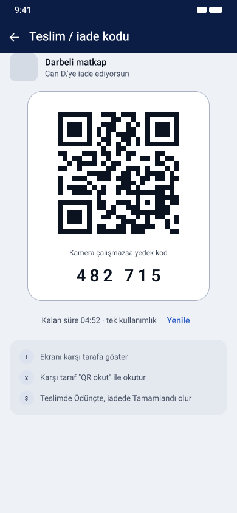
</p>

<p align="center">
  MTM4681 Mobile Programming · Yıldız Technical University · Milestone 1 (Design and architecture) 
</p>

---

## Contents
- [About the app](#about-the-app)
- [How it works](#how-it-works)
- [Key screens](#key-screens)
- [Figma: wireframes, mockups and prototype](#figma-wireframes-mockups-and-prototype)
- [Milestone 1 deliverables](#milestone-1-deliverables)
- [Team](#team)
- [Technology and architecture](#technology-and-architecture)
- [Repository structure](#repository-structure)

## About the app

On campus you suddenly need a calculator; in the dorm, an extension cord; for a weekend trip, a camping chair. Most of the time that item is just a few doors away, sitting unused. **Bende Var** ("I have it") brings people in the same community together at exactly that moment.

- Every community (school, dorm, company) has its own group. Users join it with their **institutional email**, so everyone really belongs to the same place.
- Users post a **request** for something they want to borrow or buy. Someone who has the item replies **"Bende var"** with an offer.
- The two sides agree on the price or the loan period by messaging each other.
- There is no in-app payment. Payment happens face to face or by bank transfer (IBAN).
- Borrowed items come with **return reminders**. Handover and return are confirmed with a **QR code**.

## How it works

| 1 · Join | 2 · Ask or share | 3 · Agree | 4 · Hand over and get it back |
| --- | --- | --- | --- |
| Sign up with your institutional email; you automatically join your school's community. | Post a request, or list an item you can lend or sell; reply "Bende var" to someone else's request. | Compare the offers you receive, negotiate by message, accept one. | Confirm the handover by scanning a QR code when you meet; get a reminder on the return day, complete the return with a QR code and rate the other person. |

## Key screens

> The designs use the "E · Midnight" palette (navy #0B1D45, silver #A9B2C2, surface #EEF1F6, accent blue #2F5FC4). See the [Figma prototype](#figma-wireframes-mockups-and-prototype) for every screen and the transitions between them. The screens themselves are in Turkish.

<table>
  <tr>
    <th>Sign in<br><sub>Member 1</sub></th>
    <th>Discover<br><sub>Member 2</sub></th>
    <th>Post a listing<br><sub>Member 3</sub></th>
    <th>Messages<br><sub>Member 4</sub></th>
    <th>Profile &amp; QR<br><sub>Member 5</sub></th>
  </tr>
  <tr>
    <td align="center"><br><sub>1.01 · Welcome</sub></td>
    <td align="center">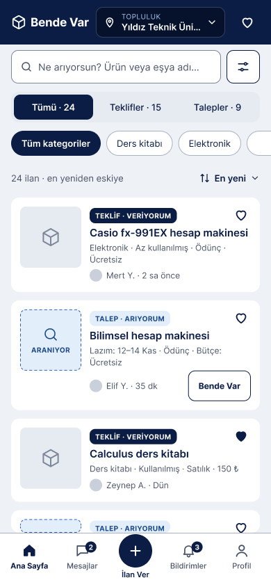<br><sub>2.01 · Home</sub></td>
    <td align="center">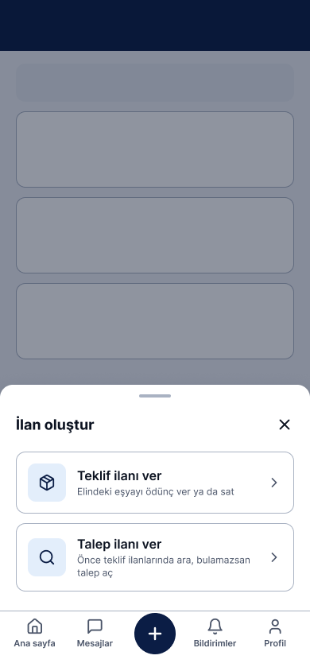<br><sub>3.01 · Create a listing</sub></td>
    <td align="center">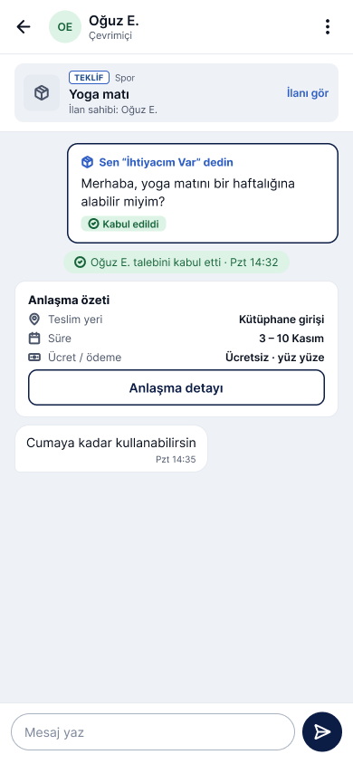<br><sub>4.05 · Chat</sub></td>
    <td align="center"><br><sub>5.01 · My profile</sub></td>
  </tr>
  <tr>
    <td align="center">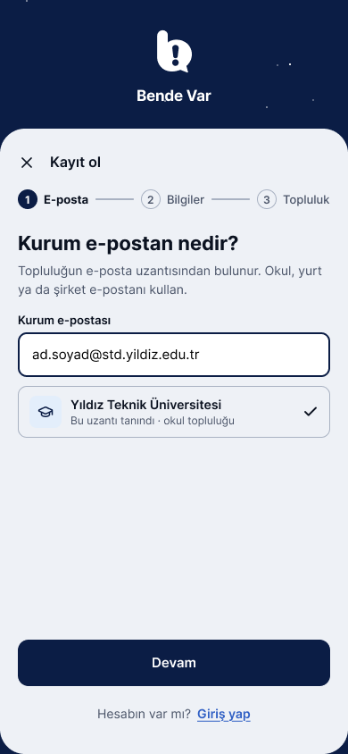<br><sub>1.08 · Sign up</sub></td>
    <td align="center">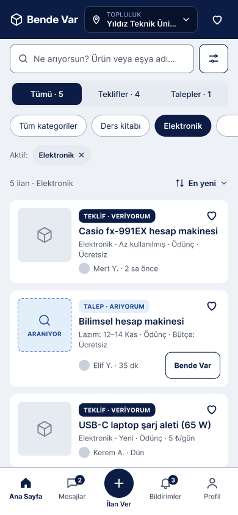<br><sub>2.07 · "Bende var" offer</sub></td>
    <td align="center">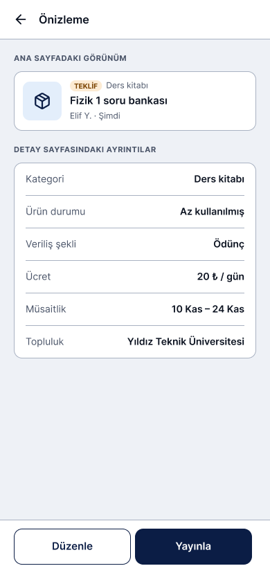<br><sub>3.06 · Listing preview</sub></td>
    <td align="center">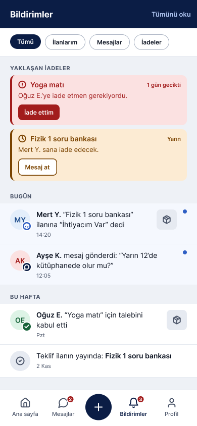<br><sub>4.07 · Notifications</sub></td>
    <td align="center"><br><sub>5.21 · QR handover code</sub></td>
  </tr>
</table>

## Figma: wireframes, mockups and prototype

All design work is in one shared Figma file. Both pages have one section per team member, and screens are numbered by module (1.xx to 5.xx) so the same number points to the same screen in the wireframes, the mockups, the prototype and the [user flow](docs/User%20Diagram.pdf).

| Content | Link |
| --- | --- |
| Figma file | [Bende Var · team file](https://www.figma.com/design/FBDlETZZpiFWFZb31av49Z/Elif-YANAR-s-team-library) |
| Wireframes | [Wireframes page](https://www.figma.com/design/FBDlETZZpiFWFZb31av49Z/Elif-YANAR-s-team-library?node-id=0-1) |
| Mockups | [Mockups page](https://www.figma.com/design/FBDlETZZpiFWFZb31av49Z/Elif-YANAR-s-team-library?node-id=3356-127) |
| Prototype | [Open the prototype](https://www.figma.com/proto/FBDlETZZpiFWFZb31av49Z/Elif-YANAR-s-team-library?node-id=3393-3680&starting-point-node-id=3393%3A3680) (starts at 1.01 Welcome) |

The prototype is built on the Mockups page and has 19 flows. In the prototype view, open the flow list in the left panel to switch between them.

| Module | Prototype flows |
| --- | --- |
| 1 · Sign in, sign up and settings | [Sign in and sign up](https://www.figma.com/proto/FBDlETZZpiFWFZb31av49Z/Elif-YANAR-s-team-library?node-id=3393-3680&starting-point-node-id=3393%3A3680) · [Settings](https://www.figma.com/proto/FBDlETZZpiFWFZb31av49Z/Elif-YANAR-s-team-library?node-id=3393-5042&starting-point-node-id=3537%3A88) |
| 2 · Home and favorites | [Home](https://www.figma.com/proto/FBDlETZZpiFWFZb31av49Z/Elif-YANAR-s-team-library?node-id=3543-4020&starting-point-node-id=3543%3A4020) · [Search](https://www.figma.com/proto/FBDlETZZpiFWFZb31av49Z/Elif-YANAR-s-team-library?node-id=3543-4743&starting-point-node-id=3543%3A4743) · [Add to favorites](https://www.figma.com/proto/FBDlETZZpiFWFZb31av49Z/Elif-YANAR-s-team-library?node-id=3543-5296&starting-point-node-id=3543%3A5296) · [My favorites and details](https://www.figma.com/proto/FBDlETZZpiFWFZb31av49Z/Elif-YANAR-s-team-library?node-id=3543-5734&starting-point-node-id=3543%3A5734) · [Bulk remove](https://www.figma.com/proto/FBDlETZZpiFWFZb31av49Z/Elif-YANAR-s-team-library?node-id=3543-6366&starting-point-node-id=3543%3A6366) · [Filter favorites](https://www.figma.com/proto/FBDlETZZpiFWFZb31av49Z/Elif-YANAR-s-team-library?node-id=3543-6621&starting-point-node-id=3543%3A6621) · [Empty favorites](https://www.figma.com/proto/FBDlETZZpiFWFZb31av49Z/Elif-YANAR-s-team-library?node-id=3543-6953&starting-point-node-id=3543%3A6953) |
| 3 · Creating requests and offers | [Post an offer](https://www.figma.com/proto/FBDlETZZpiFWFZb31av49Z/Elif-YANAR-s-team-library?node-id=3481-11138&starting-point-node-id=3481%3A11138) · [Post a request](https://www.figma.com/proto/FBDlETZZpiFWFZb31av49Z/Elif-YANAR-s-team-library?node-id=3481-11925&starting-point-node-id=3481%3A11925) · [My offer listing](https://www.figma.com/proto/FBDlETZZpiFWFZb31av49Z/Elif-YANAR-s-team-library?node-id=3481-12621&starting-point-node-id=3481%3A12621) · [My request listing](https://www.figma.com/proto/FBDlETZZpiFWFZb31av49Z/Elif-YANAR-s-team-library?node-id=3481-12962&starting-point-node-id=3481%3A12962) |
| 4 · Messaging and notifications | [Messages](https://www.figma.com/proto/FBDlETZZpiFWFZb31av49Z/Elif-YANAR-s-team-library?node-id=3509-2448&starting-point-node-id=3509%3A2448) · [Chat](https://www.figma.com/proto/FBDlETZZpiFWFZb31av49Z/Elif-YANAR-s-team-library?node-id=3509-2966&starting-point-node-id=3509%3A2966) · [Notifications](https://www.figma.com/proto/FBDlETZZpiFWFZb31av49Z/Elif-YANAR-s-team-library?node-id=3509-3964&starting-point-node-id=3509%3A3964) · [Notification permission and push](https://www.figma.com/proto/FBDlETZZpiFWFZb31av49Z/Elif-YANAR-s-team-library?node-id=3509-4470&starting-point-node-id=3509%3A4470) |
| 5 · Profile and transactions | [Profile](https://www.figma.com/proto/FBDlETZZpiFWFZb31av49Z/Elif-YANAR-s-team-library?node-id=3537-88&starting-point-node-id=3537%3A88) · [Accepting an offer and handover](https://www.figma.com/proto/FBDlETZZpiFWFZb31av49Z/Elif-YANAR-s-team-library?node-id=3537-1120&starting-point-node-id=3537%3A1120) · [Return and rating](https://www.figma.com/proto/FBDlETZZpiFWFZb31av49Z/Elif-YANAR-s-team-library?node-id=3537-590&starting-point-node-id=3537%3A590) |

## Milestone 1 deliverables

| # | Deliverable | Where |
| --- | --- | --- |
| 1 | Design justification (PDF) | [docs/Design_Justification.pdf](docs/Design_Justification.pdf) |
| 2 | User flow diagram (PDF) | [docs/User_Diagram.pdf](docs/User_%20Diagram.pdf) |
| 3 | Wireframes | [Figma · Wireframes page](https://www.figma.com/design/FBDlETZZpiFWFZb31av49Z/Elif-YANAR-s-team-library?node-id=0-1) |
| 4 | Mockups | [Figma · Mockups page](https://www.figma.com/design/FBDlETZZpiFWFZb31av49Z/Elif-YANAR-s-team-library?node-id=3356-127) |
| 5 | Prototype | [Figma · Prototype](https://www.figma.com/proto/FBDlETZZpiFWFZb31av49Z/Elif-YANAR-s-team-library?node-id=3393-3680&starting-point-node-id=3393%3A3680) |
| 6 | Architecture and protocols (PDF) | [docs/Architecture_and_Protocols.pdf](docs/Architecture_and_Protocols.pdf) |

## Team

| # | Name | Module | Screens | GitHub |
| --- | --- | --- | --- | --- |
| 1 | Eda | Sign in, sign up and settings | 1.01–1.21 | [@edahacioglu](https://github.com/edahacioglu) |
| 2 | Emine | Home and favorites | 2.01–2.36 | [@eminenurbaldik](https://github.com/eminenurbaldik) |
| 3 | Sena | Creating requests and offers | 3.01–3.18 | [@rsenagul](https://github.com/rsenagul) |
| 4 | Elif | Messaging and notifications | 4.01–4.09 | [@ElifYanarr](https://github.com/ElifYanarr) |
| 5 | Sudem | Profile and transaction management | 5.01–5.23 | [@B-S-Y](https://github.com/B-S-Y) |

## Technology and architecture

| Layer | Used |
| --- | --- |
| App | Flutter (Dart), Android |
| Design pattern | MVVM: View (widgets) → ViewModel → Repository → Service |
| State management | Provider (`ChangeNotifier` ViewModels) |
| Authentication | Firebase Authentication (institutional email, verification link, password reset) |
| Data | Cloud Firestore (real-time listeners, offline persistence, security rules) |
| Notifications | Firebase Cloud Messaging for new responses and messages; `flutter_local_notifications` for return reminders |
| Photos | `image_picker`; photos are uploaded and only their URLs are stored in Firestore |
| QR handover and return | `qr_flutter` (show code) and `mobile_scanner` (scan code) |
| Local settings | `shared_preferences` (theme and language) |

**MVVM.** We follow the [Flutter app architecture guide](https://docs.flutter.dev/app-architecture/guide). Each layer only talks to the one next to it, so screens never call Firebase directly:

```
View  →  ViewModel  →  Repository  →  Service (Firebase / device API)
      ←  data comes back as a Future or a Stream  ←
```

| Part | Role in Bende Var |
| --- | --- |
| View | The screens from Figma. Shows the current state (data, loading, empty, error) and sends user actions to its ViewModel. No business logic. |
| ViewModel | A `ChangeNotifier` that holds the state of one screen or flow and exposes commands such as `publishListing`, `sendMessage` and `acceptOffer`. |
| Repository | The single source of truth for one type of data (listings, responses, messages, transactions). Turns raw data into models and handles errors. |
| Service | A thin, stateless wrapper around Firebase or a device API. |
| Model | Plain Dart classes: `User`, `Community`, `Listing`, `Response`, `Message`, `Transaction`, `Review`. |

Every module in the Team table uses the same structure:

| Module | Main ViewModels | Main Repositories |
| --- | --- | --- |
| 1 · Sign in and settings | AuthViewModel, SettingsViewModel | AuthRepository, UserRepository, CommunityRepository |
| 2 · Home and favorites | HomeViewModel, FavoritesViewModel | ListingRepository, FavoriteRepository |
| 3 · Requests and offers | CreateListingViewModel, MyListingViewModel | ListingRepository, ImageRepository |
| 4 · Messaging and notifications | ChatViewModel, NotificationsViewModel | ChatRepository, NotificationRepository |
| 5 · Profile and transactions | ProfileViewModel, TransactionViewModel | ResponseRepository, TransactionRepository |

**Transaction flow.** A user answers a listing with "Bende Var" (or "İhtiyacım Var" on an offer) and a chat opens. When the owner accepts, a transaction is created and moves through these states: **Awaiting handover → On loan → Completed.** If the return date passes, the loan is marked **Overdue**. For a purchase, the transaction is completed at the handover. Handover and return are confirmed in person: one phone shows a QR code and the other scans it; if the camera does not work, the code can be typed in manually. After the return both sides rate each other.

**Scope that may change.** We start on Firebase's free Spark plan. Push notifications sent from the server (FCM) and Cloud Storage for photos need the paid Blaze plan, so if we stay on Spark, notifications are shown inside the app and photos go to a free image host (for example Cloudinary). Because Views and ViewModels only depend on repository interfaces, such a change only affects one Repository or Service. Details are in [architecture and protocols](docs/Architecture_and_Protocols.pdf).

## Repository structure

```
BendeVar/
├── README.md
└── docs/
    ├── Design_Justification.pdf
    ├── User_Diagram.pdf
    ├── Architecture_and_Protocols.pdf
    └── screens/           # screen images used in this README
```
